# Kvist & Bjælke ApS – Login Platform

Compulsory assignment, CDS Security & Infrastructure, 3rd semester Computer Science, Group 2.

- **Group members:** Alexandr Hrad, Mirek Ondroušek
- **Repository:** https://github.com/mirekondro/kvist-bjaelke-login

## Contents

- [Part 1 – CDS.security](#part-1--cdssecurity)
  1. [The login platform](#11-the-login-platform)
  2. [Roles and authorization](#12-roles-and-authorization)
  3. [Authentication](#13-authentication)
  4. [Password handling](#14-password-handling)
  5. [Other security measures](#15-other-security-measures)
  6. [Known limitations](#16-known-limitations-and-what-we-would-do-in-a-real-company)
  7. [Screenshots](#17-screenshots)
- [Part 2 – CDS.infrastructure](#part-2--cdsinfrastructure)
  1. [IP addressing plan](#21-ip-addressing-plan)
  2. [Subnetting](#22-subnetting)
  3. [Network diagram](#23-network-diagram)
  4. [Server on VLAN 571](#24-server-on-vlan-571)
  5. [Docker deployment](#25-docker-deployment-of-the-login-platform)
  6. [Client on VLAN 570](#26-client-on-vlan-570)
  7. [Firewall and communication between VLANs](#27-firewall-and-communication-between-vlans)
  8. [Challenges and solutions](#28-challenges-and-solutions)
- [Final reflection](#final-reflection)
- [How to run the project](#how-to-run-the-project)

---

# Part 1 – CDS.security

## 1.1 The login platform

The login platform is a web application where employees log in with a username and password. After login they see a table of users. Depending on their role they can also create, edit and delete users.

### Technology stack

| Part | Choice | Why |
|---|---|---|
| Framework | **ASP.NET Core Razor Pages (.NET 10)** | Server-rendered web app with security features built in: cookie authentication, role-based authorization, CSRF protection (antiforgery tokens) and automatic HTML encoding against XSS. We know C# from earlier semesters. |
| Database | **SQLite via Entity Framework Core** | One database file, no separate database server needed, easy to run in a Docker volume. EF Core always uses parameterized queries, which protects against SQL injection. |
| Password hashing | **BCrypt (BCrypt.Net-Next)** | Slow, salted password hashing algorithm made for passwords (see [1.4](#14-password-handling)). |
| Hosting | **Docker (multi-stage build) + Docker Compose** | The assignment requires a container. Compose lets us set the port, environment variables and a volume for the database in one file. |

### Project structure

```
src/LoginPlatform/
├── Program.cs                 # authentication, authorization, rate limiting, admin seeding
├── Models/User.cs, Role.cs    # user entity (Username, PasswordHash, Role)
├── Data/AppDbContext.cs       # EF Core database context (unique index on Username)
├── Services/
│   ├── PasswordService.cs     # BCrypt hash + verify
│   ├── UserPermissions.cs     # who may manage which role
│   └── UserPrincipalFactory.cs# builds the identity stored in the auth cookie
└── Pages/
    ├── Account/               # Login, Logout, AccessDenied
    └── Users/                 # Index (list), Create, Edit, Delete
```

## 1.2 Roles and authorization

| Action | User | SuperUser | Admin |
|---|:---:|:---:|:---:|
| Read the user table | ✅ | ✅ | ✅ |
| Create / edit / delete **Users** | ❌ | ✅ | ✅ |
| Create / edit / delete **SuperUsers and Admins** | ❌ | ❌ | ✅ |

**All checks happen on the server**, not only by hiding buttons in the browser:

- Every page requires login (`AuthorizeFolder("/")`). Only the `/Account` pages (login, logout) are open.
- The Create, Edit and Delete pages have `[Authorize(Roles = "SuperUser,Admin")]`. A normal User who types `/Users/Create` in the address bar gets *Access denied*.
- Inside each page the server checks the **target user's role** with `UserPermissions.CanManage()`. A SuperUser cannot edit or delete an Admin, even by guessing the URL `/Users/Edit/1`.
- When editing, the server checks both the **current and the new role**. Otherwise a SuperUser could change the role value in the form (for example with the browser's developer tools) and promote a User to Admin.
- Nobody can delete themselves or change their own role. This makes sure there is always at least one Admin left.

## 1.3 Authentication

We use **cookie-based authentication** (ASP.NET Core Cookie Authentication).

1. The user submits the login form (username + password).
2. The server looks up the user and checks the password against the stored BCrypt hash.
3. If it is correct, the server creates an identity with the user's ID, username and role and stores it in the cookie `kb.auth`. The cookie content is **encrypted and signed** by ASP.NET Core Data Protection, so the user cannot read or change it (for example to change their role to Admin).
4. The browser sends the cookie with every request. **On every request the server checks the cookie against the database.** If the user has been deleted or their role has changed, they are logged out immediately (see [1.5](#15-other-security-measures)).

Cookie settings:

| Setting | Value | Why |
|---|---|---|
| `HttpOnly` | true | JavaScript cannot read the cookie, so an XSS attack cannot steal the session. |
| `SameSite` | Strict | The browser does not send the cookie with requests from other websites (protection against CSRF). |
| Lifetime | 30 minutes, sliding | A forgotten session on a shared computer expires on its own. |
| Logout | POST with antiforgery token | Another website cannot log the user out with a simple link. |

### Alternatives we considered

| Alternative | Why we did not choose it |
|---|---|
| **JWT tokens** | Made for APIs and single-page apps. We have a server-rendered website, so a cookie is simpler. A JWT is also hard to revoke before it expires, and if it is stored in `localStorage` it can be stolen by XSS. |
| **ASP.NET Core Identity** | The full Identity framework gives account lockout, 2FA and password reset, but it adds many tables and generated pages. We wanted to understand and explain each security decision ourselves, so we built a small solution with the same building blocks (cookie auth + a proven hashing library). In a real company we would consider Identity. |
| **External login (Microsoft Entra ID / OAuth)** | Best for a real company (single sign-on, MFA), but it needs an external identity provider and internet access from the server, which we do not have on the school VLANs. |

## 1.4 Password handling

**Passwords are hashed, not encrypted.** Encryption can be reversed by anyone who has the key. A hash is one-way: the original password cannot be calculated back from it. Even if someone steals the database, they do not get the passwords.

We use **BCrypt with work factor 12**:

- **Salt:** BCrypt generates a random salt for every password and stores it inside the hash. Two users with the same password get different hashes, and precomputed "rainbow tables" do not work.
- **Slow on purpose:** with work factor 12 one hash takes a noticeable fraction of a second. That is fine for one login, but it makes it very slow for an attacker to try millions of passwords against a stolen hash. The work factor can be increased later when computers get faster.
- **Verification:** at login, `BCrypt.Verify(password, storedHash)` hashes the entered password with the salt from the stored hash and compares the results. The plaintext password is never stored or logged.

What is stored in the database (`Users` table):

| Column | Example |
|---|---|
| Username | `Mathilda` |
| PasswordHash | `$2…$12$…` (algorithm version, cost 12, salt and hash in one string) |
| Role | `User` |

Other password rules:

- New passwords must be at least 8 characters.
- The first Admin account is created from the environment variables `ADMIN_USERNAME` / `ADMIN_PASSWORD` in a `.env` file. The password is **never in the source code or in Git** (`.env` is in `.gitignore`, only `.env.example` with a placeholder is committed).

### Alternatives we considered

| Algorithm | Assessment |
|---|---|
| **Argon2id** | Currently the first recommendation from OWASP, because it is also memory-hard (harder to crack with GPUs). It is not built into .NET, so it needs a third-party package (for example Konscious.Security.Cryptography), and its memory and time parameters must be tuned to the server. BCrypt is mature, well tested and still considered secure, so we chose BCrypt. Argon2id would be our choice for a new production system. |
| **PBKDF2** | Built into .NET and used by ASP.NET Identity. Secure with enough iterations, but easier to speed up on GPUs than BCrypt. |
| **SHA-256 / MD5** | **Not suitable.** They are designed to be fast, so an attacker can try billions of passwords per second. Without a salt they are also open to rainbow tables. |
| **Encryption (e.g. AES)** | **Not suitable.** If the key is stolen together with the database, all passwords can be decrypted. The server never needs to know the original password, only to check it. |

## 1.5 Other security measures

| Threat | Protection in our platform |
|---|---|
| **Brute-force / password guessing** | Rate limiting: max **5 login attempts per minute per IP address**. The 6th attempt gets HTTP 429 *Too many login attempts*. |
| **User enumeration** | The error message is always *Invalid username or password*. If the username does not exist, we still verify a dummy BCrypt hash, so the response time is the same and an attacker cannot tell which usernames exist. |
| **Stale permissions** | The role is stored in the cookie, so a deleted or demoted user would keep their old rights until the cookie expires. We therefore check the cookie against the database on every request and log the user out if they no longer exist or their role has changed. |
| **SQL injection** | All database access goes through Entity Framework Core, which uses parameterized queries. |
| **XSS (cross-site scripting)** | Razor automatically HTML-encodes all output, e.g. a username like `<script>` is shown as text. |
| **CSRF** | All forms contain an antiforgery token that is checked on POST, plus `SameSite=Strict` cookies. |
| **Open redirect** | After login we only redirect to a `ReturnUrl` if it is a local URL (`Url.IsLocalUrl`). |
| **Privilege escalation via form tampering** | Role changes are validated on the server ([1.2](#12-roles-and-authorization)). |
| **Container security** | The container runs as the unprivileged `app` user, not root. The runtime image contains no SDK or source code (multi-stage build). Secrets come from `.env`, not from the image. |

## 1.6 Known limitations and what we would do in a real company

- **No HTTPS:** on the school network the platform runs on plain HTTP (port 8080), so passwords travel unencrypted between client and server. In production we would put a reverse proxy (e.g. Nginx or Traefik) with a TLS certificate in front of the container and set the cookie to `Secure`.
- **Rate limiting per IP address:** many users behind the same NAT share the limit, and an attacker with many IP addresses can avoid it. An additional per-account lockout would help, but it can also be abused to lock out other users on purpose.
- **No two-factor authentication (2FA)** and no password reset.
- **No audit log** of logins and changes.
- **Usernames are case-sensitive** (`Admin` and `admin` are different users).
- **SQLite** is fine for a small company, but a database server (e.g. PostgreSQL) would be better for many simultaneous users and backups.

## 1.7 Screenshots

| | |
|---|---|
| **Login page** 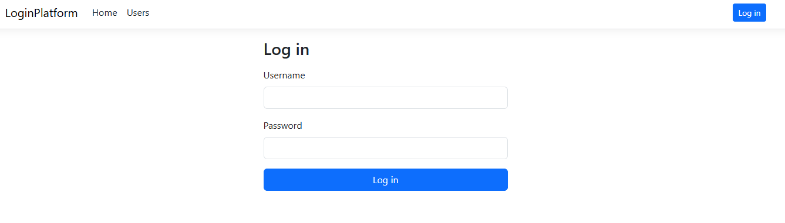 | **Admin** – can edit and delete all users 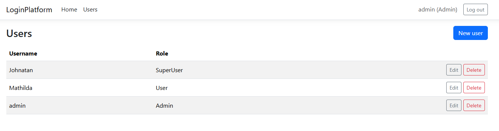 |
| **SuperUser** – can only manage the User `Mathilda`, not the Admin or another SuperUser 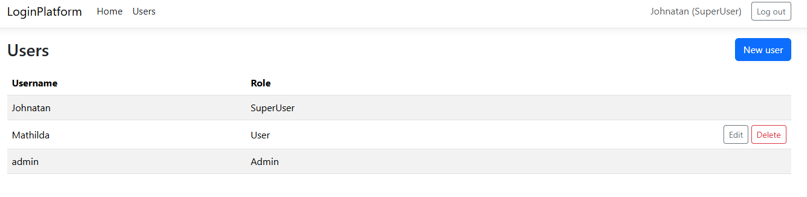 | **User** – can only read the table, no buttons 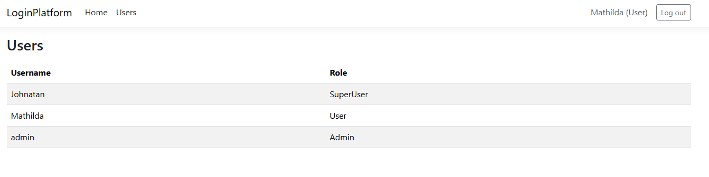 |
| **Create user** (as Admin, all roles available) 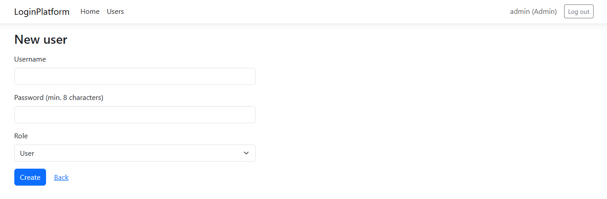 | **Rate limiting** after 5 failed login attempts 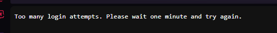 |

---

# Part 2 – CDS.infrastructure

## 2.1 IP addressing plan

The company uses the private range `10.5.0.0/16` (part of RFC 1918 `10.0.0.0/8`). This matches the two networks we were given: VLAN 570 = `10.5.70.0/24` and VLAN 571 = `10.5.71.0/24`.

Design rules:

- **VLAN 57X always uses the network 10.5.7X.0**, so you can see the VLAN from the IP address (e.g. `10.5.73.12` is a printer on VLAN 573).
- **The gateway is always `.1`** (a VLAN interface on the firewall).
- **Subnet sizes fit the number of devices**, with room for growth.

| VLAN | Name | Network (CIDR) | Subnet mask | Gateway | Usable hosts | Devices today | Addressing |
|---|---|---|---|---|---|---|---|
| **570** | Clients | `10.5.70.0/24` | 255.255.255.0 | 10.5.70.1 | 254 | 15 desktops + 10 laptops (also via staff Wi-Fi) | DHCP |
| **571** | Servers | `10.5.71.0/24` | 255.255.255.0 | 10.5.71.1 | 254 | 3 servers incl. the login platform | Static |
| 572 | Voice | `10.5.72.0/26` | 255.255.255.192 | 10.5.72.1 | 62 | 12 IP phones | DHCP |
| 573 | Printers | `10.5.73.0/28` | 255.255.255.240 | 10.5.73.1 | 14 | 3 network printers | DHCP reservation |
| 574 | Surveillance | `10.5.74.0/27` | 255.255.255.224 | 10.5.74.1 | 30 | 6 IP cameras | Static |
| 575 | Guest Wi-Fi | `10.5.75.0/24` | 255.255.255.0 | 10.5.75.1 | 254 | Visitor devices | DHCP (short lease) |
| 579 | Management | `10.5.79.0/28` | 255.255.255.240 | 10.5.79.1 | 14 | Firewall, switches, 4 access points | Static |

### Why segment the network?

If servers, employee PCs, printers, phones, cameras and guests were all on one flat network, a guest could reach the servers directly, a hacked camera or printer could attack employee PCs, and broadcast traffic would reach every device. With VLANs, all traffic between groups passes the firewall, where we decide what is allowed.

- **570 Clients:** employee PCs and laptops. The staff SSID `KB-Staff` is also mapped to VLAN 570, so laptops get the same access with cable or Wi-Fi. Only this VLAN may reach the login platform.
- **571 Servers:** hold the company's data. Separated from users and reachable only through the firewall on specific ports.
- **572 Voice:** separated so calls can be prioritized (QoS) and problems on the client network do not affect telephony.
- **573 Printers** and **574 Surveillance:** IoT-like devices that are often poorly updated. Isolated so they cannot be used to attack other devices. Cameras may only talk to the video recorder.
- **575 Guest Wi-Fi:** untrusted devices get internet access only, no internal networks, with client isolation on the access points.
- **579 Management:** management interfaces of the network equipment, reachable only for IT admins.

### Static IP vs. DHCP

| Type | Used for | Why |
|---|---|---|
| Static | Servers, network equipment, cameras | Users, other systems and firewall rules depend on these addresses never changing. |
| DHCP reservation | Printers | Always the same address, but managed centrally on the DHCP server. |
| DHCP | Clients, IP phones, guests | Many devices that come and go. No manual work, no address conflicts. Guests get a short lease so addresses are freed quickly. |

The firewall acts as DHCP server for every VLAN. In each /24, `.2–.49` is for static addresses, `.50–.99` for reservations and `.100–.250` is the DHCP pool.

Details: [docs/network/ip-plan.md](docs/network/ip-plan.md)

## 2.2 Subnetting

Usable hosts = 2^(32 − prefix) − 2. We subtract the **network address** (first) and the **broadcast address** (last).

| | VLAN 572 Voice | VLAN 573 Printers | VLAN 574 Surveillance |
|---|---|---|---|
| Network address | `10.5.72.0` | `10.5.73.0` | `10.5.74.0` |
| Prefix / mask | /26 – 255.255.255.192 | /28 – 255.255.255.240 | /27 – 255.255.255.224 |
| Host bits | 6 → 64 addresses | 4 → 16 addresses | 5 → 32 addresses |
| **Usable hosts** | **62** | **14** | **30** |
| Usable range | .1 (gateway) – .62 | .1 (gateway) – .14 | .1 (gateway) – .30 |
| Broadcast | `10.5.72.63` | `10.5.73.15` | `10.5.74.31` |
| Devices today | 12 phones | 3 printers | 6 cameras |

**Why these sizes:**

- **Voice /26:** a /28 (14 hosts) would be almost full with 12 phones. Usually every employee gets a phone, and there are already 25 employee computers. A /26 gives room for about 5× today's phones without renumbering.
- **Printers /28:** 3 printers + gateway. A /29 (6 hosts) would leave only 2 free addresses. A /28 leaves 10, which is enough because printers are added slowly.
- **Surveillance /27:** 6 cameras, but companies often add cameras (entrances, parking, storage). A /27 allows 4× growth.
- **Clients, servers and guests /24:** 254 hosts. The client network has room for new employees and their devices. The number of guests cannot be predicted.

**Future expansion:** every network has free addresses left. The ranges `10.5.76.0–10.5.78.255` and everything from `10.5.80.0` up are free for new VLANs. The management network is the tightest (about 9 devices in 14 addresses) and can be changed to a /27 if needed.

## 2.3 Network diagram

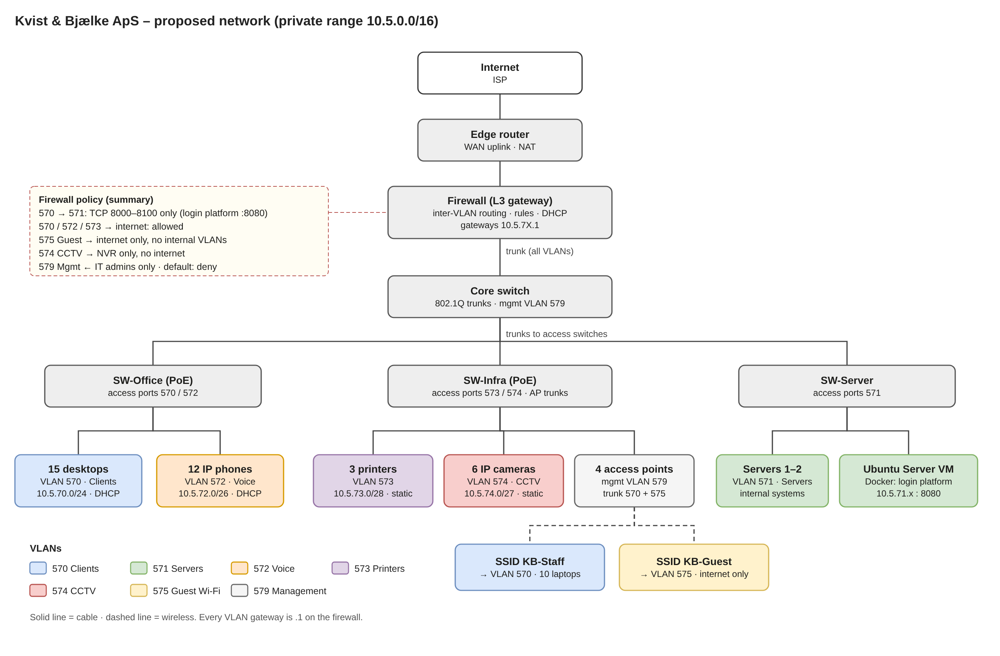

Editable source: [docs/network/network-diagram.drawio](docs/network/network-diagram.drawio) (open in draw.io).

The edge router connects the company to the internet. The firewall is the gateway for all VLANs: it routes between them and applies the rules. The core switch connects to three access switches with 802.1Q trunks. The access points carry both SSIDs on a trunk: staff Wi-Fi to VLAN 570, guest Wi-Fi to VLAN 575.

## 2.4 Server on VLAN 571

The virtual machines run on the school's **Proxmox VE 9.2** host (node `pve02`).

| Parameter | Value |
|---|---|
| VM | ID 102, name `kb-server` |
| Operating system | Ubuntu Server 26.04.1 LTS |
| Resources | 2 vCPU, 4 GB RAM, 20 GB disk |
| Network | VirtIO NIC on the Proxmox bridge `VLAN571` (the bridge that is connected to VLAN 571) |
| IP address | `10.5.71.234/24` (from the school's DHCP) |
| Default gateway | `10.5.71.5` |
| Application port | TCP 8080 |

The server got its address from DHCP in the school lab. In a real company a server should have a **static IP or a DHCP reservation**, so the address never changes and users and firewall rules can rely on it (see [2.1](#21-ip-addressing-plan)). The gateway in the school network is `.5`; in our own company proposal we use `.1`.

| Proxmox hardware – NIC on bridge `VLAN571` | Ubuntu Server installed |
|---|---|
| 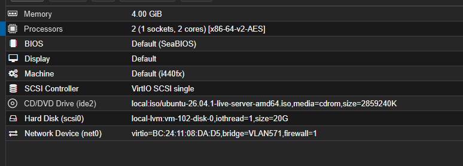 | 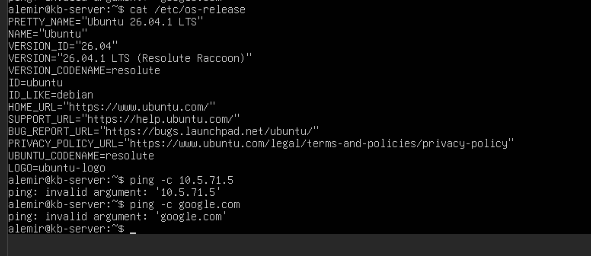 |

| IP configuration (`ip a`, `ip route`) | Gateway and internet reachable |
|---|---|
| 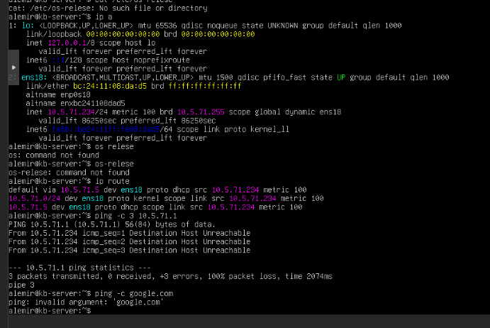 | 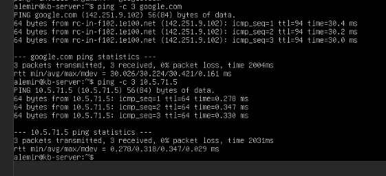 |

`ip a` shows `10.5.71.234/24` on `ens18`, and `ip route` shows `default via 10.5.71.5`. The first `ping 10.5.71.1` in the screenshot fails because the school gateway is `.5`, not `.1` (see [2.8](#28-challenges-and-solutions)).

## 2.5 Docker deployment of the login platform

Docker was installed with Docker's official installation script:

```bash
curl -fsSL https://get.docker.com | sudo sh
sudo usermod -aG docker $USER     # run docker without sudo
newgrp docker
docker --version
docker run hello-world
```

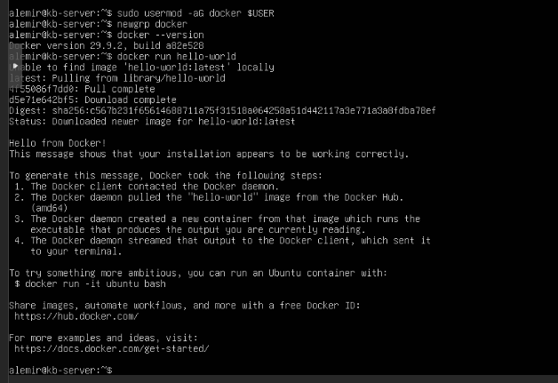

**Dockerfile (multi-stage build):**

1. **Build stage** (`dotnet/sdk:10.0`): restores the NuGet packages and publishes the app in Release mode.
2. **Runtime stage** (`dotnet/aspnet:10.0`): contains only the compiled app. It runs as the unprivileged `app` user and listens on `0.0.0.0:8080` (all interfaces, not only localhost, otherwise it would not be reachable from outside the container).

**docker-compose.yml:**

- maps port `8080:8080` (host:container),
- reads `ADMIN_USERNAME` / `ADMIN_PASSWORD` from `.env` for the first Admin,
- stores the SQLite database and the cookie encryption keys in the named volume `kb-data`, so the data survives restarts and rebuilds,
- `restart: unless-stopped` starts the app again after a server reboot.

**Port choice – 8080:** it is inside the allowed range 8000–8100, it is the common "alternative HTTP" port, and the official .NET container images listen on 8080 by default.

Deployment:

```bash
git clone https://github.com/mirekondro/kvist-bjaelke-login.git
cd kvist-bjaelke-login
git checkout dev                        # branch with the Docker files at the time of the lab
cp .env.example .env && nano .env       # set a strong admin password
docker compose up -d --build
docker ps
curl -I http://localhost:8080
```

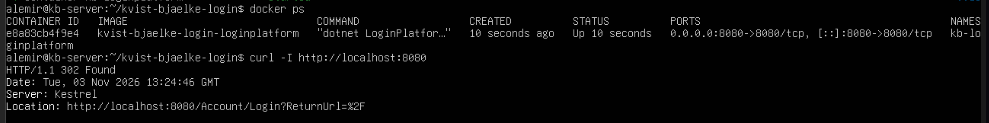

`docker ps` shows the container `kb-loginplatform` running with `0.0.0.0:8080->8080/tcp`. `curl` returns `302 Found` with a redirect to `/Account/Login`, which is correct: a user who is not logged in is sent to the login page.

## 2.6 Client on VLAN 570

| Parameter | Value |
|---|---|
| VM | `kb-client` on Proxmox node `pve02` |
| Operating system | Ubuntu Desktop |
| Network | VirtIO NIC on bridge `vmbr0` **without a VLAN tag** (VLAN 570 is the native/untagged VLAN on the uplink) |
| IP address | `10.5.70.172/24` (DHCP) |
| Default gateway | `10.5.70.5` |

Tests from the client:

```bash
ip a                                # 10.5.70.172/24 on ens18
ip route                            # default via 10.5.70.5
nc -zv 10.5.71.234 8080             # TCP port 8080 on the server is reachable
curl -I http://10.5.71.234:8080     # the web application answers
```

| IP configuration and TCP connection to the server | HTTP request to the server |
|---|---|
| 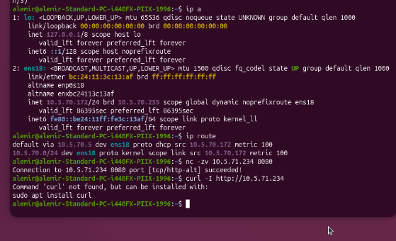 | 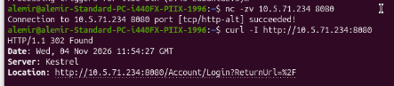 |

The client on VLAN 570 (`10.5.70.172`) reaches the server on VLAN 571 (`10.5.71.234`) on TCP port 8080 through the gateway and firewall.

**Using the login platform from the client** (Firefox, `http://10.5.71.234:8080`):

| Login page | Admin – manages all users |
|---|---|
| 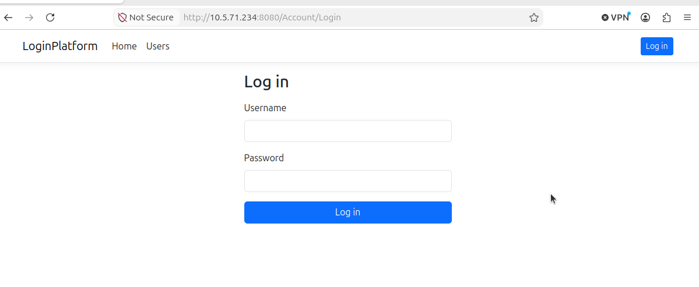 | 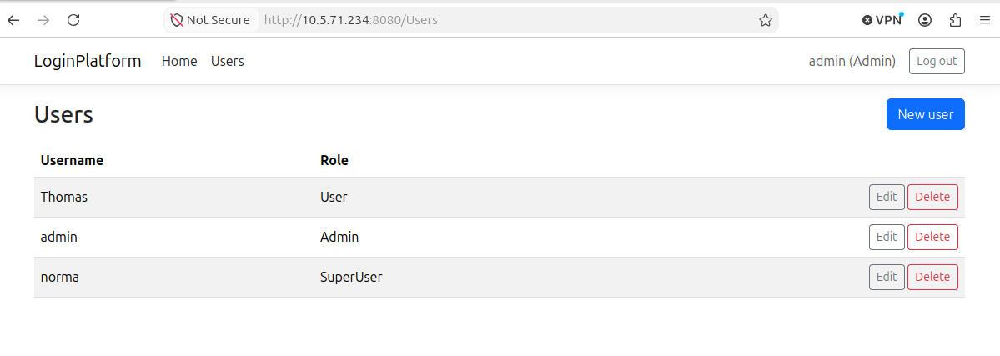 |

| SuperUser – can only manage the User `Thomas` | User – read only |
|---|---|
| 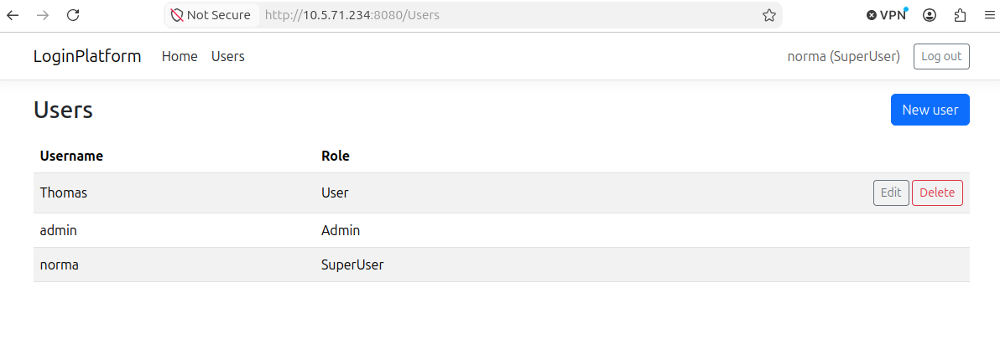 | 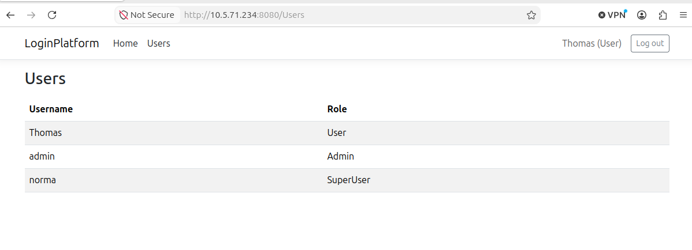 |

All three roles work from the client machine exactly as in [1.2](#12-roles-and-authorization).

## 2.7 Firewall and communication between VLANs

The school firewall allows traffic from VLAN 570 to VLAN 571 on TCP 8000–8100. We did not configure it ourselves.

**Why are VLAN 570 and 571 separate networks?**
Clients and servers have different trust levels. Client PCs are used for e-mail, browsing and USB sticks, so they are the most likely to be infected. Servers hold the company's data. Separate VLANs are separate broadcast domains, and traffic between them must pass a point (the firewall) where it can be controlled.

**Why does communication between VLANs require routing?**
Each VLAN is its own IP network (`10.5.70.0/24` and `10.5.71.0/24`). A switch only forwards traffic inside the same VLAN (layer 2). When the client sends to `10.5.71.x`, it sees that the address is on another network and sends the packet to its default gateway (`10.5.70.5` in the school network). The router/firewall (layer 3) has an interface in both VLANs and forwards the packet based on the destination IP address.

```
Client 10.5.70.172 ──> gateway 10.5.70.5 ──[router/firewall]── 10.5.71.5 ──> Server 10.5.71.234
     VLAN 570                                                                          VLAN 571
```

**The role of the firewall**
Because all traffic between VLANs passes through it, the firewall decides what is allowed based on source, destination, protocol and port. Everything not explicitly allowed is blocked (default deny). It is stateful: replies to a client's connection are allowed back automatically, but the server cannot open new connections to the clients. It can also log blocked attempts.

**Why allow only specific ports?**
This is the principle of least privilege. The server may run other services (SSH on 22, a database, management interfaces). With only TCP 8000–8100 open, a compromised client cannot reach them, and malware that spreads through SMB (445), RDP (3389) or SSH (22) cannot jump from the client VLAN to the servers. It also makes the rules easy to audit.

A side effect: ICMP is not in the allowed rule, so `ping` from client to server may fail even though the web application works. We therefore tested with `nc` and `curl`.

## 2.8 Challenges and solutions

| Challenge | Solution |
|---|---|
| **Client VM got no IP address.** The Proxmox host had a bridge `VLAN571` for the servers, but no bridge called `VLAN570`. We connected the client to `vmbr0` with VLAN tag 570, but it only got a link-local address `169.254.x.x` (no answer from DHCP). With a temporary static IP we could not reach `10.5.70.1` or `10.5.70.5` either. | We asked our teacher: VLAN 570 is the **native (untagged) VLAN** on the uplink `vmbr0`. Our tag 570 made the switch drop the frames, because it does not expect tagged frames for that VLAN. We removed the VLAN tag. |
| **Client still had a 169.254.x.x address after the tag was removed.** Because the client was installed while the network did not work, Ubuntu had set IPv4 to `link-local` and did not even ask for DHCP. | Changed the connection to DHCP: `sudo nmcli connection modify netplan-ens18 ipv4.method auto` and `nmcli connection up netplan-ens18`. The client got `10.5.70.172/24`. |
| **Ping to the gateway `10.5.71.1` failed** on the server. | `ip route` showed that the default gateway in the school network is `10.5.71.5`, not `.1`. Ping to `.5` and to the internet worked. |
| **`.env.example` not found after `git clone` on the server.** | `git clone` downloads the default branch `main`, but the Docker files were only on `dev` at that time. `git checkout dev` solved it. |
| **`apt install curl` failed with `404 Not Found`** on the client. | The package list was out of date, because the client was installed without network. `sudo apt update` first fixed it. |
| A deleted or demoted user kept their old role until the cookie expired, because the role is stored in the cookie. | Added a check of every cookie against the database (`OnValidatePrincipal`), see [1.5](#15-other-security-measures). |
| After pulling new code, Rider could not build (`NETSDK1004: project.assets.json not found`, "cannot resolve" everywhere). | The NuGet packages had not been restored. Running `dotnet restore` fixed it. |
| `docker compose up` stopped with *Set ADMIN_PASSWORD in the .env file*. | This is on purpose: the admin password must not be in Git. We created a local `.env` from `.env.example`, on our PCs and again on the server. |

Screenshots of the client network problem:

| Only a link-local address (no DHCP) | Gateways unreachable with a test IP |
|---|---|
| 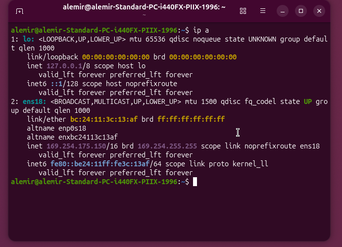 | 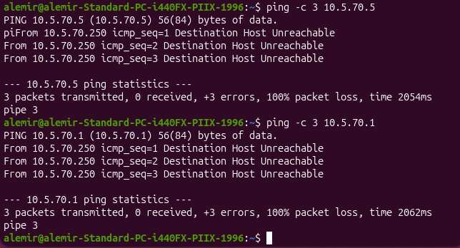 |

| NIC on `vmbr0` without tag | IPv4 method was `link-local` |
|---|---|
| 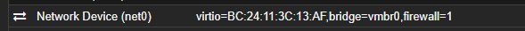 | 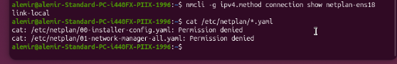 |

---

# Final reflection

### How are security and infrastructure interconnected?

A secure application is not enough on its own. The infrastructure decides who can reach it and how. Our login platform hashes passwords with BCrypt, checks roles on the server and protects against CSRF and brute-force attempts. But it only runs on plain HTTP on the school network, so without TLS a password can still be read on the way from the client to the server. The infrastructure also adds its own layers of security: servers and clients are in separate VLANs, and the firewall only allows traffic from VLAN 570 to VLAN 571 on TCP ports 8000–8100. Even if another service on the server had a weakness, a client could not reach it. Security decisions in the code and in the network depend on each other. For example, keeping the admin password out of Git only works because Docker Compose reads it from a local `.env` file on the server.

### What technical challenges did you encounter?

Most problems were in the network, not in the code. The client VM did not get an IP address, because we had tagged it with VLAN 570, but VLAN 570 is the native (untagged) VLAN on the Proxmox bridge. Ubuntu had also fallen back to a link-local address and stopped asking for DHCP, so we had to switch it back with `nmcli`. On the server, the default gateway was `10.5.71.5` and not `.1` as we expected, which we found with `ip route`. In the code, the hardest part was getting the roles right: a SuperUser must not be able to promote a user to Admin by changing the value in the form, and a deleted or demoted user must lose their rights immediately, not when the cookie expires. We also learned to keep build output (`bin/`, `obj/`) and secrets out of Git with a proper `.gitignore`.

### What did you learn about deploying an application on a server?

Docker made the deployment predictable. The same `docker compose up -d --build` command worked on our laptops and on the Ubuntu server, and the multi-stage build gives a small runtime image without the SDK or source code that runs as a non-root user. We learned that data must live in a volume, otherwise the database disappears when the container is rebuilt, and that configuration and secrets belong in environment variables, not in the image. We also learned that troubleshooting on a server is done step by step: first the IP configuration (`ip a`), then routing (`ip route`, `ping`), then the port (`nc`, `curl`), and only then the application itself.

### What would you do differently if the solution were to be deployed in a real company?

We would put a reverse proxy with a TLS certificate in front of the container and mark the cookie as `Secure`, so passwords and sessions are never sent unencrypted. We would replace SQLite with a database server such as PostgreSQL with regular backups, and add two-factor authentication, a password reset flow, an audit log of logins and changes, and per-account lockout in addition to the per-IP rate limit. On the infrastructure side we would implement the full network design from the diagram (separate VLANs for printers, IP phones, cameras and guests), add monitoring of the server and container, and deploy new versions automatically through a CI/CD pipeline instead of `git pull` on the server.

---

# How to run the project

Requirements: Docker with Docker Compose.

```bash
git clone https://github.com/mirekondro/kvist-bjaelke-login.git
cd kvist-bjaelke-login
cp .env.example .env        # then change ADMIN_PASSWORD
docker compose up -d --build
```

Open `http://localhost:8080` and log in with the admin account from `.env`.

The admin account is only created on the first start, when the database is empty. To start over with an empty database: `docker compose down -v`.
